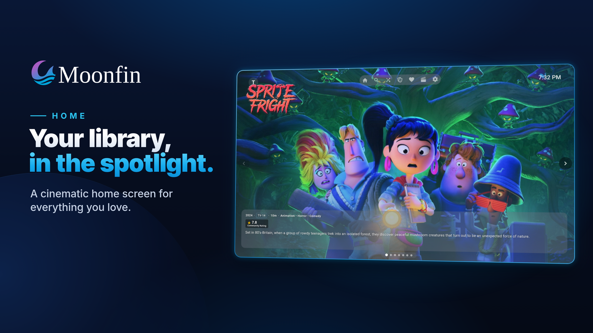
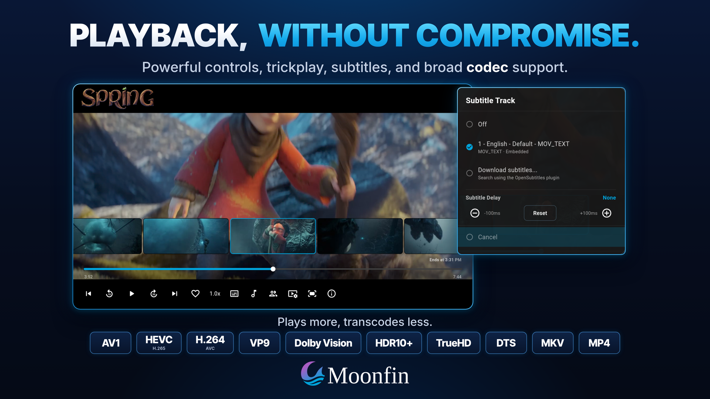
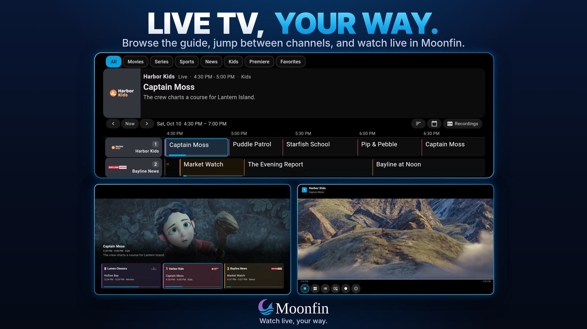
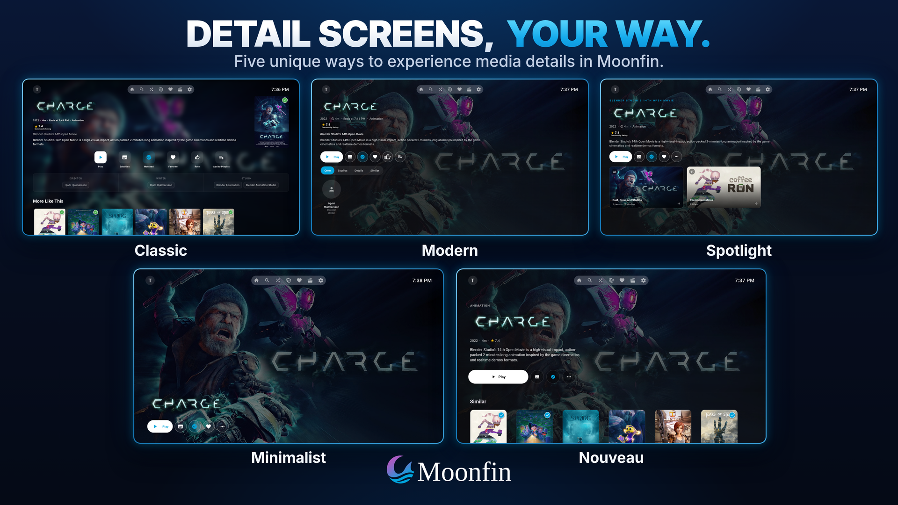
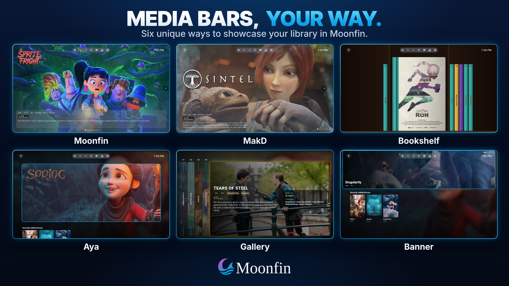
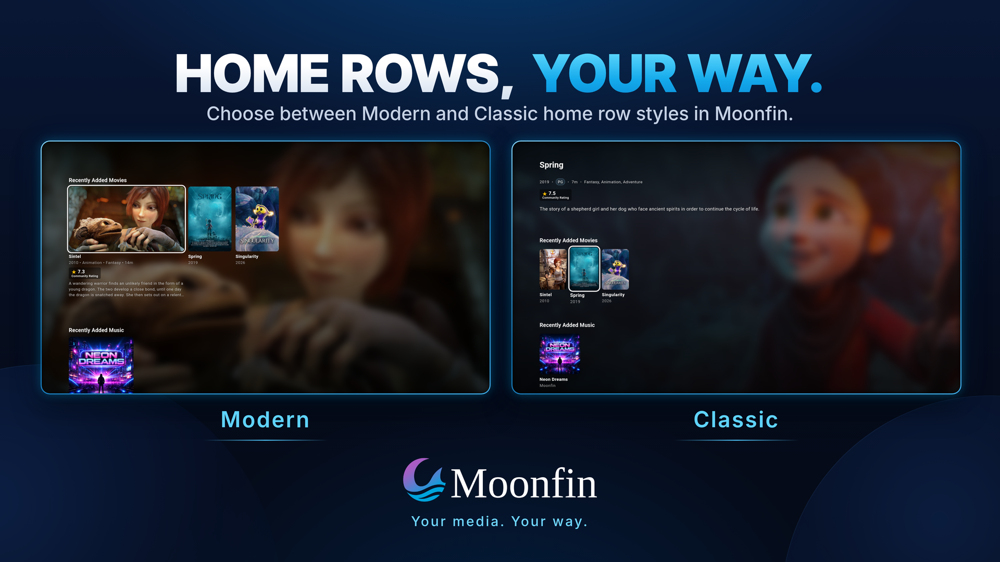
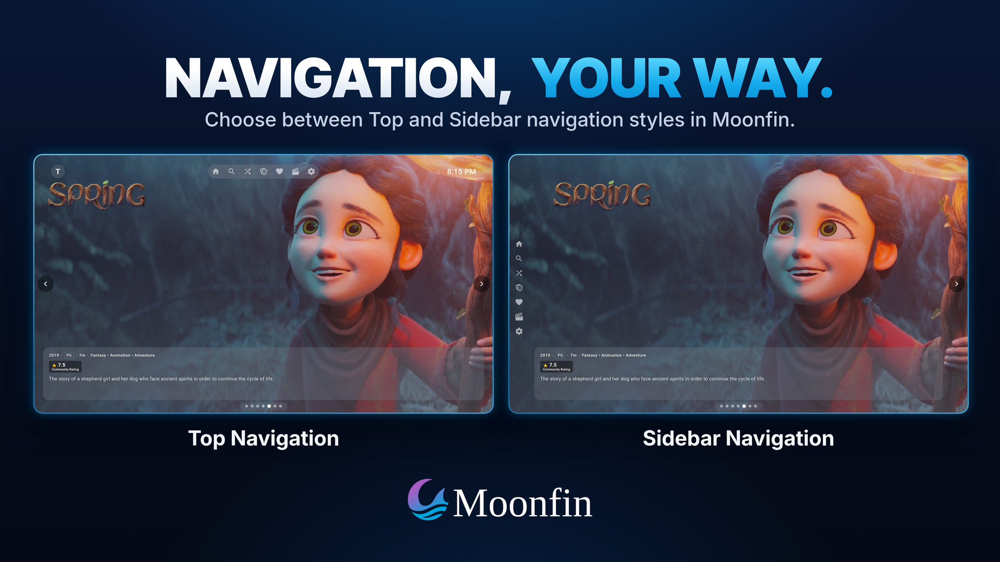
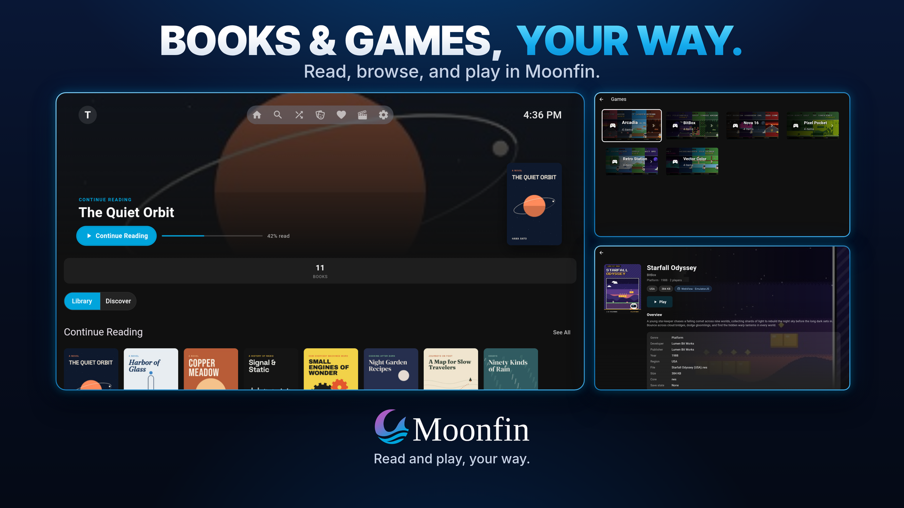
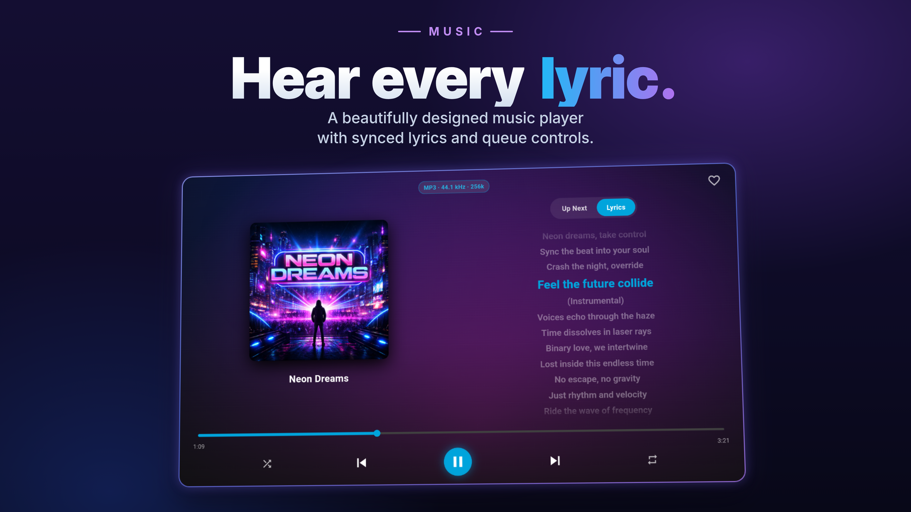

<h1 align="center">Moonfin for Smart-TVs</h1>
<h3 align="center">Premium Jellyfin and Emby client for webOS and Tizen TVs</h3>

---

<p align="center">
   
</p>

[](https://github.com/Moonfin-Client/Smart-TV)
[](https://github.com/Moonfin-Client/Smart-TV/releases)
[](https://github.com/Moonfin-Client/Smart-TV/releases)
[](https://www.amazon.com/Moonfin/dp/B0H76BG3DW)
[![Microsoft Store](https://img.shields.io/badge/Microsoft%20Store-107C10?logo=data:image/svg%2Bxml;base64,PHN2ZyByb2xlPSJpbWciIHZpZXdCb3g9IjAgMCAyNCAyNCIgeG1sbnM9Imh0dHA6Ly93d3cudzMub3JnLzIwMDAvc3ZnIj48cGF0aCBmaWxsPSIjZmZmIiBkPSJNNC4xMDIgMjEuMDMzQzYuMjExIDIyLjg4MSA4Ljk3NyAyNCAxMiAyNGMzLjAyNiAwIDUuNzg5LTEuMTE5IDcuOTAyLTIuOTY3IDEuODc3LTEuOTEyLTQuMzE2LTguNzA5LTcuOTAyLTExLjQxNy0zLjU4MiAyLjcwOC05Ljc3OSA5LjUwNS03Ljg5OCAxMS40MTd6bTExLjE2LTE0LjQwNmMyLjUgMi45NjEgNy40ODQgMTAuMzEzIDYuMDc2IDEyLjkxMkMyMy4wMDIgMTcuNDggMjQgMTQuODYxIDI0IDEyLjAwNGMwLTMuMzQtMS4zNjUtNi4zNjItMy41Ny04LjUzNiAwIDAtLjAyNy0uMDIyLS4wODItLjA0Mi0uMDYzLS4wMjItLjE1Mi0uMDQ1LS4yODEtLjA0NS0uNTkyIDAtMS45ODUuNDM0LTQuODA1IDMuMjQ2ek0zLjY1NCAzLjQyNmMtLjA1Ny4wMi0uMDgyLjA0MS0uMDg2LjA0MkMxLjM2NSA1LjY0MiAwIDguNjY0IDAgMTIuMDA0YzAgMi44NTQuOTk4IDUuNDczIDIuNjYxIDcuNTMzLTEuNDAxLTIuNjA1IDMuNTc5LTkuOTUxIDYuMDgtMTIuOTEtMi44Mi0yLjgxMy00LjIxNi0zLjI0NS00LjgwNi0zLjI0NS0uMTMxIDAtLjIyMy4wMjEtLjI4MS4wNDZ2LS4wMDJ6TTEyIDMuNTUxUzkuMDU1IDEuODI4IDYuNzU1IDEuNzQ2Yy0uOTAzLS4wMzMtMS40NTQuMjk1LTEuNTIxLjMzOUM3LjM3OS42NDYgOS42NTkgMCAxMS45ODQgMEgxMmMyLjMzNCAwIDQuNjA1LjY0NiA2Ljc2NiAyLjA4NS0uMDY4LS4wNDYtLjYxNS0uMzcyLTEuNTItLjMzOUMxNC45NDYgMS44MjggMTIgMy41NDUgMTIgMy41NDV2LjAwNnoiLz48L3N2Zz4%3D)](https://apps.microsoft.com/detail/9plb327dd51d)
[](https://www.buymeacoffee.com/moonfin) 
[](https://discord.gg/moonfin)

> **[Back to main Moonfin project](https://github.com/Moonfin-Client)**

## What is Moonfin for Smart TVs?

Moonfin is a Jellyfin and Emby client for Samsung Smart TVs (Tizen), LG Smart TVs (webOS), Fire TV sticks running Vega OS and Xbox consoles. One shared codebase powers every platform, with a video pipeline tuned for each, so you get hardware-accelerated playback, a UI designed around a remote instead of a mouse, and features that most TV clients leave out.

## Features

- **Hardware-accelerated playback** through Samsung AVPlay, webOS Starfish, the Fire TV WebView and the Xbox console's own player, with direct play first and a transcode fallback only when needed.
- **Lossless audio passthrough** for DTS, DTS-HD, and Dolby TrueHD to a capable receiver.
- **Multi-server and Emby support**, including Emby Connect, Quick Connect, and a unified library view across all your Jellyfin servers.
- **A setup wizard on first run** that walks you through the look of the app with live previews built from your own artwork, including five detail screen styles: Classic, Modern, Spotlight, Nouveau, and Minimalist.
- **Kids Mode and Blocked Ratings.** Kids Mode strips the app back for a child and locks the way out with a PIN, and blocked ratings apply everywhere, from home rows and search to detail screens and playback.
- **A proper on-screen keyboard** with layouts that follow your language, plus sign-in that finds servers on your network by itself.
- **Native Seerr integration** for browsing, discovering, and requesting content in HD or 4K from your TV, with requests, issue reporting, and a watchlist button built into the detail screen.
- **Retro games** played right on the TV from a server game library, with save states synced through the server. Needs webOS 5 or Tizen 5 and newer. See [Retro Games](https://github.com/Moonfin-Client/Plugin/wiki/Retro-Games).
- **Live TV and DVR** with a program guide that opens on your last channel, a quick channel changer during live playback, and recording management.
- **Advanced subtitles**, including PGS image subtitles and styled ASS/SSA through libass, plus in-app subtitle downloads.
- **SyncPlay and remote control**, for watching together in sync with others and for driving the TV from other Jellyfin apps, including typing a search from your phone.
- **Themes** with four built-in looks including Glass and 8-bit Hero, a Theme Store for community themes, custom themes, and accent color customization. Loading animations and the screensaver's backdrop, clock or logo are yours to customize with a live preview, and screens show skeleton placeholders while they load.
- **A featured media bar** with six layouts, including the rounded Aya hero.
- **Personal ratings** as a like, stars, or a score out of ten, usable as a library filter.
- **Achievement Badges** on Jellyfin servers that run the Achievement Badges plugin, and **anime markers** like Filler, Manga Canon, and Subbed/Dubbed on cards and detail screens from the Moonbase plugin.
- **Automatic performance tuning** that matches visual effects to how capable your TV is, with a manual override.
- **Wide device support**, from Samsung 2016 sets (Tizen 2.4) and LG webOS 3.0 through the latest models, including Let's Encrypt support on older webOS models whose built-in certificate stores are out of date.

The full list is on the [Features](https://github.com/Moonfin-Client/Smart-TV/wiki/Features) wiki page.

## Screenshots

<p align="center">
  
</p>
<p align="center">
  
  
</p>
<p align="center">
  
  
</p>
<p align="center">
  
  
</p>
<p align="center">
  
  
</p>

**Disclaimer:** Screenshots shown in this documentation feature media content, artwork, and actor likenesses for demonstration purposes only. None of the media, studios, actors, or other content depicted are affiliated with, sponsored by, or endorsing the Moonfin client or the Jellyfin project. All rights to the portrayed content belong to their respective copyright holders. These screenshots are used solely to demonstrate the functionality and interface of the application.

## Installation

Fire TV sticks running Vega OS can get Moonfin from the [Amazon Appstore](https://www.amazon.com/Moonfin/dp/B0H76BG3DW), and Xbox consoles from the [Microsoft Store](https://apps.microsoft.com/detail/9plb327dd51d). Samsung and LG don't carry it in their TV app stores (yet), so there it's installed by sideloading. On LG the closest thing to a store is the **Homebrew Channel**, which lists Moonfin and updates it like any other app, no root needed. Everyone else downloads a package from the [Releases page](https://github.com/Moonfin-Client/Smart-TV/releases) and picks the file that matches the TV:

| Platform | File | Supported Devices |
|---|---|---|
| **Tizen Regular** | `Moonfin_Tizen_Regular_v*.wgt` | Samsung Smart TVs (2017+, square icon) |
| **Tizen Oblong** | `Moonfin_Tizen_Oblong_v*.wgt` | Samsung Smart TVs (2017+, oblong icon) |
| **Tizen Legacy** | `Moonfin_Tizen_Legacy_v*.wgt` | Samsung Smart TVs (2016, Tizen 2.4) |
| **webOS** | `Moonfin_webOS_v*.ipk` | LG Smart TVs (2016+, webOS 3.0+) |
| **Vega** | `Moonfin_Vega_v*.vpkg` | Fire TV sticks on Vega OS (Fire TV Stick 4K Select and newer) |

The easiest route on each brand:

- **LG:** the Homebrew Channel if your TV has it. Otherwise LG's Developer Mode app plus [Dev Manager Desktop](https://github.com/webosbrew/dev-manager-desktop), a free desktop program that installs the `.ipk` in a few clicks. The webOS CLI (`ares-install`) works too.
- **Samsung:** the [Apps2Samsung](https://github.com/Apps2Samsung/Apps2Samsung) tool, which signs and installs the `.wgt` for you.
- **Fire TV (Vega OS):** the [Amazon Appstore](https://www.amazon.com/Moonfin/dp/B0H76BG3DW). The `.vpkg` from the Releases page can still be sideloaded with Developer Mode on the stick and the Vega SDK's `vega device install-app` on a computer.
- **Xbox:** the [Microsoft Store](https://apps.microsoft.com/detail/9plb327dd51d). The `.zip` from the Releases page can still be sideloaded on a console in Developer Mode through the Xbox Device Portal.
  - The console draws every app's interface at 1080p and scales it up to the TV, so on a 4K set the text and posters look a little softer than the TV's own apps. That is how Xbox runs apps, Plex and Jellyfin look the same, and video is not affected: it goes through the console's own player at 4K and in HDR.

Step-by-step instructions for all of them, including turning on Developer Mode, are on the [Installation and Sideloading](https://github.com/Moonfin-Client/Smart-TV/wiki/Installation-and-Sideloading) page. Once installed, [Getting Started](https://github.com/Moonfin-Client/Smart-TV/wiki/Getting-Started) walks through connecting to your server.

Seerr is optional and connects through the [Moonfin server plugin](https://github.com/Moonfin-Client/Plugin) rather than directly, so nothing needs to be entered on the TV. See [Seerr Setup](https://github.com/Moonfin-Client/Smart-TV/wiki/Seerr-Setup).

## Documentation

The deeper reference material lives in the [Wiki](https://github.com/Moonfin-Client/Smart-TV/wiki):

| Page | What it covers |
|------|----------------|
| [Features](https://github.com/Moonfin-Client/Smart-TV/wiki/Features) | The full feature list, section by section |
| [Playback and Codecs](https://github.com/Moonfin-Client/Smart-TV/wiki/Playback-and-Codecs) | Video pipelines, direct play and fallback, audio passthrough, and subtitles |
| [Installation and Sideloading](https://github.com/Moonfin-Client/Smart-TV/wiki/Installation-and-Sideloading) | Which release file to pick, and how to sideload on Samsung and LG |
| [Getting Started](https://github.com/Moonfin-Client/Smart-TV/wiki/Getting-Started) | Connecting to your server, Quick Connect, the setup wizard, and the settings worth a look on day one |
| [User Guide](https://github.com/Moonfin-Client/Smart-TV/wiki/User-Guide) | The remote inside the player, typing on a TV, themes, home rows, and parental controls |
| [Common Problems](https://github.com/Moonfin-Client/Smart-TV/wiki/Common-Problems) | Plain fixes for connection, login, install, playback, sound and subtitle trouble |
| [Seerr Setup](https://github.com/Moonfin-Client/Smart-TV/wiki/Seerr-Setup) | Connecting Seerr through the Moonfin server plugin |
| [Building from Source](https://github.com/Moonfin-Client/Smart-TV/wiki/Building-from-Source) | Build scripts, the three Tizen variants, and dev servers |
| [Development](https://github.com/Moonfin-Client/Smart-TV/wiki/Development) | Project structure, platform abstraction, and developer notes |
| [Collecting Logs](https://github.com/Moonfin-Client/Smart-TV/wiki/Collecting-Logs) | Diagnostic logging and what to attach to an issue |

## Building

```bash
npm install
npm run build:tizen:all   # Samsung: Regular, Oblong, and Legacy
npm run build:webos       # LG
npm run build:xbox        # Xbox, on Windows with the Visual Studio Build Tools
```

A current Node.js LTS release (20 or newer) with npm is the only prerequisite.

<details>
<summary><b>Advanced:</b> where the build CLIs live</summary>

`npm install` also sets up the build CLIs in the git-ignored `tools/` directory, which keeps them out of the lockfile on purpose. See `tools/package.json` for the reasoning. Full details, including the individual variant builds and the dev servers, are on [Building from Source](https://github.com/Moonfin-Client/Smart-TV/wiki/Building-from-Source).

</details>

## Contributing

Contributions are welcome. Check the existing issues first, open an issue before starting a large change, match the existing code style, and test on real Samsung or LG hardware where you can. See [Development](https://github.com/Moonfin-Client/Smart-TV/wiki/Development) for how the codebase is laid out and how platform-specific code is kept isolated.

To submit a change, fork the repo, create a feature branch, make your changes with clear commit messages, and open a pull request with a clear description.

## Help translate Moonfin [here](https://translate.moonfin.io/projects/moonfin/smart-tv/)

<a href="https://translate.moonfin.io/projects/moonfin/smart-tv/">
  
</a>

## Support and Community

- **Issues** for bugs and feature requests: [GitHub Issues](https://github.com/Moonfin-Client/Smart-TV/issues)
- **Discussions** for questions and ideas: [GitHub Discussions](https://github.com/Moonfin-Client/Smart-TV/discussions)
- **Jellyfin** for server-related questions: [jellyfin.org](https://jellyfin.org)

## Credits

Moonfin is built on the work of others:

- **[Jellyfin Project](https://jellyfin.org)** for the media server
- **[Enact](https://enactjs.com)** for the React-based framework for TV apps
- **Jellyfin Tizen and webOS Contributors** for the original clients
- **Moonfin Contributors** for everything they have added to the project

## License

This project is licensed under the MPL 2.0 license. Some parts incorporate content licensed under the Apache 2.0 license. All images are taken from and licensed under the same license as https://github.com/jellyfin/jellyfin-ux. See the [LICENSE](LICENSE) file for details.

---
<p align="center">
   <strong>Moonfin for Smart TVs</strong> is an independent client and is not affiliated with the Jellyfin or Emby projects.<br>
   <a href="https://github.com/Moonfin-Client">Back to main Moonfin project</a>
</p>

---

## About this fork

This is a personal fork of [Moonfin for Smart TVs](https://github.com/Moonfin-Client/Smart-TV), modified by me ([Licaa21](https://github.com/Licaa21)) for my own use. Moonfin itself is made by **RadicalMuffinMan** and the Moonfin contributors, and all credit for the app belongs to them. This fork follows upstream `main` and adds the changes below on top. It isn't an official build, and the changes aren't promised to ever reach upstream.

### What I added

**Playback**
- **Standby recovery on Tizen:** playback comes back after the TV sleeps, goes to the background or is powered off, instead of leaving a black screen.
- **Force Compatible AV1 Transcode:** an opt-in setting that re-encodes AV1 to HEVC when transcoding, for Tizen sets that fail on AV1 over fragmented-MP4 HLS.
- **Channel keys:** CH +/- seek far, by five times the seek step or 3% of the runtime, wherever focus is. Previous plays the previous episode, and the TV's own channel, guide and streaming-service keys no longer close the app.
- **Episode browser:** an Episodes button in the player opens the current season on the playing episode, with season tabs, resume on pick, and CH +/- to change season. Upstream later dropped the channel keys from its copy, and this fork keeps them. It can be arranged in Player Buttons.
- **Skip prompt:** its auto-hide starts over for every episode, so it no longer vanishes early after Previous or Next.
- **Seek bar:** the focused thumb is easier to see on Tizen.
- **Back to the player from a person:** opening a person from the cast and crew list closes the player, and Back from there returns to it at the same place, with the same audio and subtitle picks and still paused if it was. The person screen, and any title opened from it, has no navbar, so the only way on is Back. The Guide, Channel List and Previous Channel buttons go straight back to the player from any of those screens. Back lands on the screen it left, the title you started playing from, and not on the last one you opened. A person opened from anywhere else keeps the navbar.
- **Subtitles move out of the way:** they slide up above the controls bar while it shows, and above the description when Show Description on Pause is on, then slide back down.
- **Direct play where the set allows it:**
  - A file that opens on a track the TV cannot decode, such as TrueHD first, is played from the first track the TV can decode, and a pick in the same codec is switched by the player.
  - A pick in another codec is built on the server with the video copied, the way a manual pick already was, so the screen and the sound agree.
  - A check a few seconds after play rebuilds the track on the server when the one playing is not the one shown.
  - A direct stream the server gives no address for is opened as a direct play.
- **Play Dolby Vision Profile 7 as HDR10:** an opt-in setting that direct plays Dolby Vision files with an enhancement layer as plain HDR10 on sets that report HDR10.
- **Allow Files With Many Streams:** an opt-in setting that lifts the 32 stream limit older Tizen sets are given, so a remux with dozens of subtitle tracks can direct play.
- **Allow HEVC Level 5.2:** an opt-in setting that lets 4K HEVC files at level 5.2 direct play on 4K Tizen sets, which the profile otherwise stops at 5.1 and sends to be re-encoded.

**Subtitles and audio**
- **Preferred Languages** subtitle mode: your preferred language, then your secondary one, and off when neither is in the file.
- **Audio Codec Priority:** rank codecs from best to worst, applied after your audio language.
- **Details buttons:** the Audio and Subtitle buttons show the track playback will actually start on.
- **Anime audio language:** a language and a fallback of their own for anime, while everything else keeps the default pair.
- **Prefer Stereo Tracks:** ranks a 2.0 track above a 5.1 one of the same language and codec without limiting what direct plays. Max Audio Channels at stereo does the same and also sends every 5.1 track through the server.
- **Remember Audio Track per Series:** a switch for the stored pick, so it can be turned off and the language settings win again.

**Look and layout**
- **Accent colors:** a color per part of the app, or one for everything, with focus fills kept readable.
- **Skip Intro/Recap/Credits editor:** capsule, rectangle and sweep layouts with position, size, colors and a live preview, plus card, banner and button layouts for the Next Episode prompt.
- **Search:** results drawn with the Home cards and rows, best matches first, and a setting for which tab a search opens on when Seerr has results.
- **Person pages:** redesigned with a portrait, backdrop and de-duplicated credits. The backdrop is the one title the person is known for: the series they were in for the most episodes when one ran 20 or more, and otherwise the title they are billed highest in. Cameos, walk-ons, guest spots and appearances as themselves are never picked.
- **Person pages by popularity:** the titles on a person page, the Seerr Appearances and Crew rows and the library page's Movies, Series, Guest Appearances and Music Videos rows (on the Details person screen too), are ordered by TMDB popularity, the most popular first, with the title the page's backdrop comes from ahead of them all (the series they were in for the most episodes when one ran 20 or more, otherwise the title they are billed highest in). Library titles are matched to Seerr's credits by their TMDB id, and those Seerr does not know follow by community rating. The Nouveau layout's person page has no Seerr credits to rank by and keeps its order.
- **Details:** action button rows ranked like Settings, "Read more" only when the text is cut off, anime marker pills on every layout, and a Press BACK to close hint on trailers. The classic layout offers Change Artwork, and on an episode its row of the season's episodes opens on that episode and marks it.
- **Playback Info button:** a button on a movie's or episode's details, after Subtitle, that opens a popup saying how the file would play with the audio and subtitle track picked. It runs the same start Play runs, without starting anything, so it sees every setting of this app (the stream limit, Dolby Vision, HEVC level, bitrate, the audio track that is swapped or built) and agrees with what plays. A green dot is Direct Play, amber is Direct Stream and red is Transcoding, with whether the video, the audio or both are re-encoded, the reasons and the setting that would help, and the container, bitrates, streaming limit, video, audio and subtitle. It is one of the Details action buttons, so it can be moved or hidden in Settings. Each note under Settings That Apply is a button: OK on it closes the popup and opens that setting in Settings, Playback, Quality & Decoding, with focus on it. Closing Settings, with Back as many times as it takes, brings the popup back on the same note. A Settings That Apply card names this fork's own settings when they decide how a file plays: Allow Files With Many Streams for a file over the 32 stream limit, Force Compatible AV1 Transcode for AV1, Play Dolby Vision Profile 7 as HDR10 and Allow HEVC Level 5.2. An audio pick that opens on another codec than the file's first track is not a setting, so it is told under Why ("Opens on FLAC audio, but you picked AC3", with the reason the TV's player cannot switch): the app has the server build that track with the picture copied, shown amber as Audio built on the server.
- **Upcoming rows keep the date:** on a Modern card in the Radarr and Sonarr upcoming rows, the release date stays under the title when the card is focused, instead of being replaced by the year and genres.
- **Seerr seasons and episodes:** a series only Seerr knows shows its seasons and episodes in every details style. A season bar sits over a row of episode cards, each with the still, `S2E3: Name`, air date, runtime, rating and a short description. The section reads Seasons and Episodes, and a show with dozens of seasons keeps its bar inside the screen and slides along it as focus moves. A focused tab that is also the selected one keeps a dark line inside its ring, so the two never blend. Down from the row above lands on the season bar, and Down from the bar always lands on the first episode, after a change of season too. A score under three votes, such as an unrated episode's flat 1.0, is not shown. Season 0, the specials, is left out. CH +/- step through the seasons from the season bar or the episodes, keeping focus on the episodes or on the bar, and the open season is kept in view of a bar of dozens of them whichever way it was changed. The season bar is smaller than the section tabs above it, so the two read as different levels.
  - The words are asked of Seerr in the language the Jellyfin server is set to (an administrator account can read it, and the app language is used otherwise), and English fills any episode name or description Seerr has none of in that language. With a TMDB key typed in Settings (below) they are read from TMDB itself instead.
  - **Episode popup:** OK on a card opens a popup over the screen: the still, a tag with the episode code and the series, the title in large type, pills for the air date, runtime and rating, the whole description, and the director and writers. It has a soft backdrop of its own still (without the blur from the Medium performance level down) and a Press Back to close hint. With no actor to open, nothing in it takes focus, and Up and Down read a long description.
  - **Guest stars:** under the description, headed Guest stars, the episode's guest stars show as round photos (initials when there is none) with name and role. Left and Right move along them and OK opens that person's Seerr page with no navbar, the way a person opens from the player. Back, or the Guide / Channel List button from however deep you went (actor, title, actor...), returns to the same popup on the same season and episode with that actor in focus. A star appears only when Seerr's answer, or TMDB with a key, carries it with an id.
- **One skip prompt for an intro:** when the server reports two overlapping intros, such as the Intro Skipper plugin's and the chapter based one, they are joined into one prompt that skips to where the last one ends, so a second prompt no longer appears after the first skip. The diagnostic log now names every segment the server reported and where each skip landed, and a Tizen skip that lands short of its target is made once more.
- **Skip prompt over the controls:** the prompt now shows while the player controls are up, lifted above them the way the subtitles are and lowered again when they go. With the controls away, OK skips and Back sends the prompt away, and any other key brings the controls up with the prompt still there. With the controls up, Back only closes them, Up from the playback bar focuses the prompt and Down from it goes back to the bar. Seeking into a segment offers its prompt again with the real time left, also after it was dismissed or had hidden itself, and a skip that lands a moment short of the end does not bring it back. The next episode card that replaces the credits prompt comes back the same way when it was sent away. On the channel list button (the CH label on the remote, not CH +/-), the prompt of the segment you are inside, or that card in the credits, comes back after it was dismissed or hid itself.
- **Home after playback:** the cards on Home open again after coming back from playing something. Rows drawn while Home was behind another screen kept a stale handler and opened nothing.
- **Theme song and trailers:** a trailer opened from a title's details screen takes the speakers, so the theme song fades out for it and comes back when the trailer is closed.
- **Refreshing Home and Seerr Discover:** pressing Home in the navigation while Home is open reloads its rows and the media bar, and pressing Seerr while Discover is open reloads Discover. The library scan button also refreshes Home once the server has finished scanning, so what it found shows up, and a refresh that happens while you are in the rows puts focus back on the card you were on.
- **Accent colors in more places:** the watched check on cards, the library, favorites and genre screens, the details screens and the episode browser follows the accent of its surface once one is picked. The rows of the Achievements and Friends screens follow the Achievements accent (Friends is now filed under it), and the inline marks of the Achievements screens wear the theme accent, not a fixed cyan, until one is picked. The Achievements and Friends screens are screens of Settings, so they wear the Settings accent while they have none of their own. The rank header (its icon and bar) keeps the color the server gives the rank until an accent is picked, and the ring on a focused badge follows the accent, or the focus color when none is picked.
- **Picture and ASS subtitles:** PGS and ASS subtitles slide up out of the way of the player controls and the pause description, like the text ones do, and a little further for the pause description so the tails of letters are not clipped. PGS has its own settings under Subtitle Customization (size, position, opacity, brightness and a background box with its own color and opacity, drawn behind the picture where the renderer drew it; there is no text color or shadow, since it is a picture), and the Subtitle Appearance button in the player shows those while a PGS track is on, a note for an ASS track, which is styled by its own file, and the usual text options for the rest. The webOS player gets the lift for ASS only.
- **TMDB key on the TV:** the Moonfin plugin keeps its server-wide TMDB key on the server and never sends it to a client, so the TV cannot read it. Settings, Integrations, TMDB has a field for the TV's own key (the 32 character v3 key, typed with the TV keyboard), saved a moment after typing and kept on this TV only. With it, Seerr titles and episodes are read from TMDB in the Jellyfin language, and the Since You Watched row and the upcoming episode date, which already looked for a key, find it. Ratings, studio logos, thumbnails and the seasonal row still go through the plugin and its own key.
- **Refresh libraries:** for an administrator, a refresh icon sits right beside the Libraries button in the top navbar (Right from Libraries focuses it) and on the Libraries row of the left sidebar, between the name and its arrow, where Right from the row focuses it. It scans every library on the server. The arrow turns while the server is asked, then a tick pops in for about a second, or a warning sign when it failed.
- **Search finds a translated title:** the Most relevant row on the Seerr tab ranks a title by the name it was made under as well as the translated one, so "The Wire" finds Cartelul Crimelor. A leading "The", "A" or "An" does not count against a title, so "Flash" ranks The Flash with Flash itself ahead of Flash Gordon.
- **Seerr status pill sized like its neighbours:** the pill Seerr shows on a detail screen (Available, Pending, Deleted and the like) is drawn at the size of the Continuing and Ended markers next to it in every detail style, where it used to stand taller and in Nouveau was cut at the top. In Spotlight the Continuing or Ended marker and then the Seerr pill close the facts line, set apart by the same dot as the other facts.
- **Nouveau details:** a series only Seerr knows has the same season bar, episode cards and episode popup as the other styles, and CH +/- and the focus chain work through them. Similar, recommended and filmography titles are drawn with Home's own cards, so they follow the Home card settings like the other styles. From the Medium performance level down the page jumps between rows and does not smooth scroll, which was the lag of moving down it.
- **Spotlight details:** the title, buttons and category cards sit together at the foot of the screen with the backdrop above, and not apart with a gap between them. Back from a guest star opened from an episode popup opens the Episodes category by itself and brings the popup back on that actor.
- **Rows in the metadata language:** the TMDB and custom list rows are asked of the plugin in the language the Jellyfin server is set to, and the titles in them that the library does not hold are asked of Seerr again in it before the rows are shown, so they come up once already in it and are not swapped a few seconds later, for a plugin that ignores the language (the 2.4.0 one does) or answers from a copy it kept in English, Since You Watched asks TMDB and Seerr in it, and the seasonal row's suggestions, which the plugin builds in English, are asked of Seerr again in it, so posters and titles read the way Seerr's do and the way they open. English is left as it is, and a title that cannot be had keeps its English.
- **Lighter player controls on a slow set:** from the Medium performance level down, the buttons take focus at once instead of fading, the controls layer fades faster, and the playback time is only redrawn once a second and only while something shows it, so key presses do not wait on a redraw of the whole player.
- **Control buttons on a Samsung:** from the Medium performance level down, Left and Right along the buttons under the progress bar move focus straight to the neighbour with a plain focus, without Spotlight's size and place checks (each of which made the browser lay the page out before the script could go on). The focus ring, its fill and the tooltip of each button sit in a layer of their own and are only shown or hidden, so a move draws nothing again, and look the same. A log line names any arrow press that took longer than 120 ms, split into the script's time, the handler's and the focus move's, and whether the player was drawn again meanwhile.
- **Trailers:** hls.js starts a YouTube manifest on a guess of the link and then moves to what it measures, and each move flushes the picture ahead of the playhead and loads it again while the sound, which it loads apart, plays on, which is a first play whose sound runs a second ahead. A trailer now picks one H.264 quality, the best that fits the starting guess, and keeps it. The log keeps what a trailer's element reports while it plays, and a trailer no longer jumps past a sponsor segment before it is playing.
- **Trailer button on library titles:** a movie or series in the library shows the button when it has a trailer of its own or Seerr knows one for its TMDB id, which a title requested on Seerr and then added to the library is. The lookup runs when the screen opens and is remembered for the session, and a title with no trailer anywhere has no button.
- **Seerr:** Discover drawn with the Home cards, rows and settings, and a browse grid that reads the Movies or TV Shows library's own size, shape and direction settings, so a card is the same in both. A title from a Seerr recommendation on a details screen opens as a Seerr title, with the trailer and request, and no longer as if it were in the library.
- **Seerr screen like Home:** its rows rest at the top of the list the way Home's do, with Home's room under the last row, so the focused card sits in the same place from row to row. Request cards say where the request stands (Pending, Approved, Available...) and each request has a card of its own. Every title a page brings is kept, where only the first 9 of each 20 were; a row draws nine at a time and more as focus nears the last drawn card. Upstream rebuilt this screen in its own way and the fork keeps its version, taking the request status and the titled thumb from upstream.
- **No backdrop behind tiles:** a studio, network, genre or shortcut tile has no picture behind it on Home or the Seerr screens, since it stands for a way of browsing and not a title. The studio and network logos are the same tile on Home and on the Seerr screen: each logo sits on a grey tile and keeps its own colors when they stand out from it (Netflix red, Hulu green) or is white already, and a dark logo (black, navy) is drawn white, so every one can be read without focusing it. A backdrop still loading for a card you have already passed is no longer drawn behind a tile.
- **A scrub only lands on OK:** with Pause While Scrubbing on, a scrub lands only when you press OK or Play. Anything else (Back, Up, Down, or the seek bar losing focus) drops it: nothing is seeked to, playback carries on if it was playing before, and the controls hide on Back.
- **Back from the sidebar:** with the navbar on the left, Right from the navbar goes back to the card you were on in Home, where it used to go to the first row.
- **Navigation from anywhere:** on every screen that has the navigation (Home, the Seerr screen, Details and the like) the Guide / Channel List button (not CH +/-) moves focus to the navigation from wherever you are, and back to the card or button you were on when pressed again, so the navbar is reached without Left or Up. The Library, Favorites, Genres and Live TV screens have no navigation, so the button does nothing there. Screens reached from the player still return to the player with it.
- **Which card a row opens on:** a Home setting under Looks, Remember Card in Row (on by default). On keeps upstream's behavior, where a row you move back into returns to the card you left it on. Off starts at the row's first card when you move up or down. The same choice applies on the Seerr screen.
- **Lighter Home on a slow set:** from the Medium performance level down, a Home row starts with twelve cards and draws ten more as focus gets near the last one, only the focused card has a graphics layer of its own, a key press measures the layout once fewer times, the rows after Back are drawn when the set is idle, the stored home cache is only written when it will be read back, and Home, the Seerr context and the inactivity timer render less often.
- **Home stays as it was left:** Back from a title brings Home up in the first frame, on the same row and card, with nothing loaded again: no loading screen, no media bar flashing first, no landing one row up. The whole screen is kept once it has loaded, rows and media bar included, and is only dropped by a visit of its own, a refresh, an account change, hiding or ordering a library, a media bar change, or a favorite, playlist change or delete. Continue Watching and Next Up are refreshed on a return only when something was played or marked watched.
- **Sort and filter popups:** one shared popup, with the groups on the left and the options beside them.
- **Backdrops behind the cards:** the focused card's backdrop, dimmed and blurred, now sits behind the Modern home rows, Search and the Seerr Discover and Browse screens too. It follows the same Background Backdrops switch and blur amount as before.
- **Home Rows Image Type in every row style:** Poster, Thumb, Backdrop, Banner and Logo now apply to the Modern rows as well as the Classic ones, and to the TMDB, IMDb, Seerr and Because you watched rows, which take their backdrop for the wide types.
- **Theme music on Home:** episodes in Continue Watching and Next Up play their series' theme, a theme fades out when focus moves to a card without one, and moving back to the same card keeps it going. It fades out when the screensaver comes up and comes back when the screensaver goes, on the same card or details screen.
- **Seasonal effects:** the number of particles follows the Density setting alone, and the performance level no longer thins them out.
- **Performance levels:** Ultra, High, Medium-High, Medium, Low and Performance, with the lower ones turning off idle animations and drawing long rows in steps, so a slow TV stays responsive while looking almost the same.
- **Settings titles:** the title of a Settings screen sits at the left edge, where the main Settings title does, instead of being indented. An empty TMDB field shows its hint in light grey, and in a solid blue once focused.
- **Settings:** upstream's 2.10.0 Settings layout, with this fork's own screens placed in it: Accent Colors under Appearance, the skip button look under Skipping & Autoplay, and the audio, direct play and Seerr search settings in their screens. **Settings Size** (Appearance, Display) shrinks the whole Settings list, boxes and text, to 90, 80 or 70 percent, and leaves the Settings window at its size.

**Diagnostics and translations**
- **Diagnostic log:** the in-app log keeps its recent non-network lines across restarts, so a report still has them after the app reopens. It also prints the commit the package was built from, why each start picked its audio track, the server's reason for not direct playing, why a media load failed, and the HLS playlist the TV refused, with the access token hidden.
- **Romanian:** strings added by this fork are translated by hand in `packages/app/resources/ro/strings.json`, since this fork has no Weblate project. Every English string now has a Romanian one, the strings the code used but never listed are added, and dates and prices follow the app's language and not the TV's. The Series button on an episode's details reads Serial. Watched reads Vizionat, and the subtitle position labels read Jos, Puțin mai sus, Mijloc and Sus. `node fork-tools/check-romanian.js` lists any string the code uses that has no English entry or no Romanian one, and is run after every merge from upstream.

### Where this fork differs from upstream on purpose

A merge from upstream never overwrites these. The fork keeps its own version of each:

- **Channel keys in the episode browser:** CH +/- steps between seasons and the hint stays, where upstream removed both.
- **The Seerr Discover screen:** every card is drawn with Home's cards and settings, rows rest like Home's, and every title of a page is kept. The request status, one card per request and the titled TMDB thumbnail were taken from upstream's version.
- **Studio and network tiles, and backdrops behind tiles:** one shared tile on Home and on the Seerr screen, and no backdrop behind a studio, network, genre or shortcut tile.
- **Home kept on a return:** Back from a title brings Home back as it was left instead of building and loading it again.

### Branches and updating

- `main` follows upstream Moonfin and differs from it only by this README, which is shown first on GitHub.
- `implement` is where my changes live. They are committed here and nowhere else.
- `daily` is `main` merged with `implement`, and it is only used to build the app for daily use. Nothing is committed on it by hand.
- Three changes were proposed upstream, each on its own branch: `feature/episodeselector-skipperlayout-accentcolors` (the in-player episode browser, [#494](https://github.com/Moonfin-Client/Smart-TV/pull/494)), `fix/home-rows-stale-select-handler` (Home cards that opened nothing after playback, [#534](https://github.com/Moonfin-Client/Smart-TV/pull/534), merged upstream) and `feature/skip-prompt-over-controls` (the skip prompt over the player controls, [#535](https://github.com/Moonfin-Client/Smart-TV/pull/535)).
- To pick up upstream's latest, run `bash fork-tools/update-daily.sh` on `daily`, then `bash fork-tools/build-daily-wgt.sh`. The Tizen package is the regular build, named after the upstream one with `_Lica_Fork` added, for example `Moonfin_Tizen_Regular_v2.10.0_Lica_Fork.wgt`.
- The scripts in `fork-tools/` are `update-daily.sh`, `build-daily-wgt.sh`, `link-modules.ps1` (links a branch folder's dependencies to the ones in `main`), `check-romanian.js` and `browser-mock.js` (a fake Jellyfin server with a library of 100 movies, and Seerr, for looking at screens in a browser).
- Each branch folder has a `CLAUDE.md` (ignored by git) with the working rules and what a merge must keep, and `implement` has a `TODO.md` with what is planned next. Every item in it is asked about before it is built.
